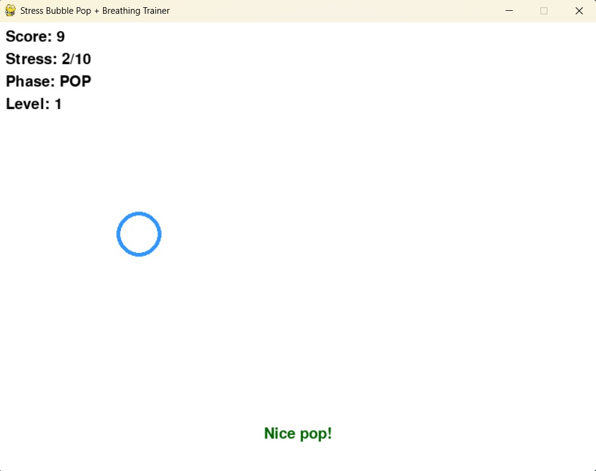
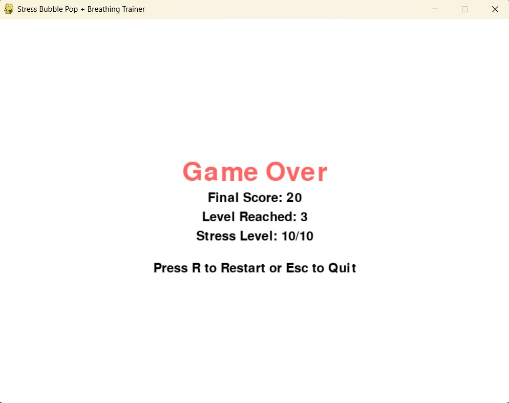
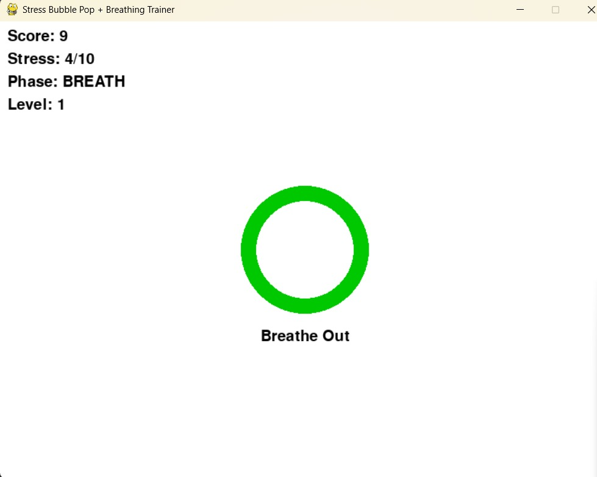

# 🧘 Stress Bubble Pop + Breathing Trainer Game

A fun and interactive mental wellness game built with **Python** and **Pygame**.

This is my second game development project — combining stress relief through bubble popping and guided breathing exercises.


## 🎯 Features

- 💥 Bubble Pop Phase with score tracking
- 🌬️ Breathing Circle Phase (Breathe In / Breathe Out)
- 😌 Positive affirmations after each bubble pop
- 😨 Stress meter increases on missed bubbles
- 📈 Score decreases on missed bubbles
- 🎮 3 Levels of increasing difficulty and bubble speed
- 🧠 Game Over when stress hits maximum or score goes negative
- 📊 Game Over screen showing final score, level, and stress

## 📸 Screenshot





## 🕹️ How to Play

- **Phase 1: Bubble Pop**
  - Click the blue bubbles before they disappear.
  - You gain points for popping bubbles.
  - Missed bubbles increase your stress and decrease your score.
  - Positive affirmations appear when a bubble is popped.

- **Phase 2: Breathing Trainer**
  - A circle grows and shrinks in the center.
  - Follow the instructions: *Breathe In* when it grows, *Breathe Out* when it shrinks.
  - No clicking needed here — just relax.

- The game cycles between these two phases every 15 seconds.


## 🧾 Game Rules

- ✅ Popping a bubble increases your score.
- ❌ Missing a bubble decreases your score and increases stress.
- 💯 Score ≥ 10 → Level Up → Bubble speed increases.
- 🚫 Score < 0 or Stress = 10 → Game Over.


## 🚀 How to Run

### 1. Clone the Repository

```bash
git clone https://github.com/your-username/stress-bubble-pop.git
cd stress-bubble-pop
````

### 2. Install Dependencies

```bash
pip install pygame
```

### 3. Run the Game

```bash
python main.py
```

> Make sure you have Python 3.x installed.

---

## 🛠️ Tech Stack

* Python 3
* Pygame Library


## 📌 Notes

* Great for beginners learning game development
* Good for personal wellness practice
* Includes animation, timing logic, and simple UI


## 💡 Future Ideas

* Add background music or relaxing sounds
* Add breathing streak counter
* Add custom affirmations from user input
* Add pause/resume feature


## 🙋‍♂️ Made by

**Abhishek Mittal**
Final year BTech student exploring Python & Game Dev.
